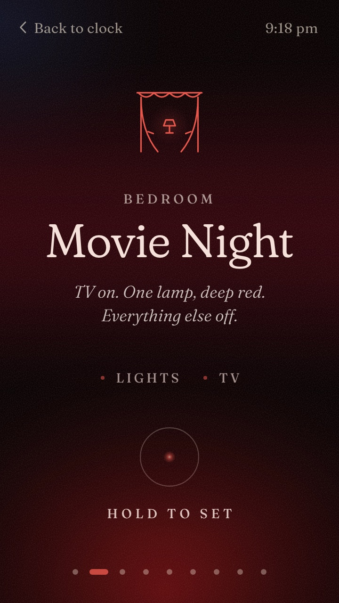
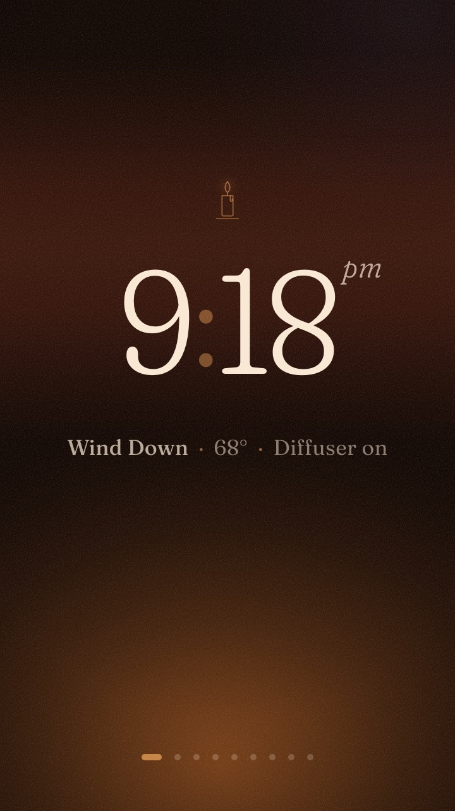

# Palm Phone Toolkit

Notes, fixes and scripts for giving the 2018 **Palm phone** (TCL-made, model PVG100 / PVG100E, codename `pepito`) a second life as a tiny smart-home display, controller or sensor.

Palm (the company) is gone, and the phone is stuck on Android 8.1 and a 2019 security patch. It's still a nice little device: a 3.3" 720p LCD screen, Wi-Fi, proximity and light sensors, a camera, and a size that fits on a wall, a desk or next to a 3D printer.

> **Warning:** rooting this phone means writing to its flash over Qualcomm EDL. Flashing the wrong model's firmware has bricked units. **Take a full backup first.** You use everything here at your own risk.

## What's here

| Path | What it is |
| --- | --- |
| [docs/identify.md](docs/identify.md) | How to tell which Palm you have (PVG100 vs PVG100E, OS, build) |
| [docs/backup-and-root.md](docs/backup-and-root.md) | Full EDL backup and Magisk root from Linux, step by step (tested on a US PVG100) |
| [docs/troubleshooting.md](docs/troubleshooting.md) | Hung edl sessions, getting out of EDL, the encryption password prompt after rooting, and more |
| [docs/ideas.md](docs/ideas.md) | Ways to use the phone with Home Assistant, 3D printers and more, with a difficulty for each |
| [patches/edl-firehose-pepito.patch](patches/edl-firehose-pepito.patch) | A small patch to [bkerler/edl](https://github.com/bkerler/edl) that makes reads and writes work reliably with the Palm's firehose loader |
| [scripts/charge-limit/](scripts/charge-limit/) | A Magisk boot script that holds the battery between 40% and 80% and pauses charging when it's hot, so an always-plugged-in Palm doesn't swell |
| [homeassistant/moods/](homeassistant/moods/) | Palm Moods: a Home Assistant mood controller for a wall or nightstand (Android home app, web UI and HA package) |

## Palm Moods

[homeassistant/moods/](homeassistant/moods/) turns a rooted PVG100 into a mood controller for Home Assistant. The phone shows a clock; tap it, swipe through moods like Wind Down, Movie Night or Lights Out, and press and hold to set one. The moods are Home Assistant scripts in one package, so voice, automations and every phone share them, and a mood names rooms ("roles") rather than devices. It comes with a Kotlin home app, a web UI built for the Palm's Chrome 101 WebView, the Home Assistant package with eight example moods and a settings dashboard (where you can also make up to six moods of your own, tune the built-in ones with sliders, and choose which phones show each mood), and a provisioning script.

 

## Device facts (US PVG100)

- SoC: Snapdragon 435 (MSM8940, firehose reports MSM8937), eMMC storage with 512-byte sectors
- Android 8.1.0, build `OPM1.171019.019`, non-system-as-root, full-disk encryption
- **No fastboot.** `adb reboot bootloader` just reboots. EDL (9008) is the only low-level way in.
- EDL loader: `Loaders/TCL/0006b0e100420041_073e81231dae45ba_fhprg_peek.bin` from bkerler's Loaders repo (edl picks it automatically)
- Battery: 800 mAh. The charge switch is at `/sys/class/power_supply/battery/battery_charging_enabled`.

## Status

| Model | Backup | Root | Charge limit |
| --- | --- | --- | --- |
| PVG100 (US / Verizon), build v1AGN (2019-03) | ✅ | ✅ Magisk 31.1 | ✅ |
| PVG100 (US / Verizon), build v3C3M (2021-04) | ✅ | ✅ Magisk 31.1 (patched on Linux) | ✅ (after the [setup hang](docs/troubleshooting.md#setup-stuck-on-initializing-please-wait-while-we-prepare-your-palm) fix) |
| PVG100E (international) | Untested here; see [3ch0less/pvg100e-root](https://github.com/3ch0less/pvg100e-root) | | |

Tested a different model or a different method? Please open a PR and add a row.

## Contributing

Scripts, dashboards, HA configs, 3D-printable mounts and corrections are all welcome. See [CONTRIBUTING.md](CONTRIBUTING.md).

## Credits and prior work

- [bkerler/edl](https://github.com/bkerler/edl) and its Loaders collection
- [topjohnwu/Magisk](https://github.com/topjohnwu/Magisk)
- XDA threads: [Root the Palm phone (Sugar QCT)](https://xdaforums.com/t/release-root-the-palm-phone.4021201/), [edl backup on Linux](https://xdaforums.com/t/guide-using-edl-to-backup-a-palm-pvg-100-pepito-on-linux.4719549/), [Treble GSI without Sugar](https://xdaforums.com/t/guide-treble-gsi-root-on-palm-phone-without-sugar_qct.4680864/), [LineageOS for pepito](https://xdaforums.com/t/rom-unofficial-a17-lineageos-24-0-for-the-palm-pvg100-pvg100e-pepito.4804726/)
- [3ch0less/pvg100e-root](https://github.com/3ch0less/pvg100e-root), [solarkennedy/lineageos-pepito](https://github.com/solarkennedy/lineageos-pepito)

Not affiliated with Palm, TCL or Verizon. Licensed under the MIT License.
