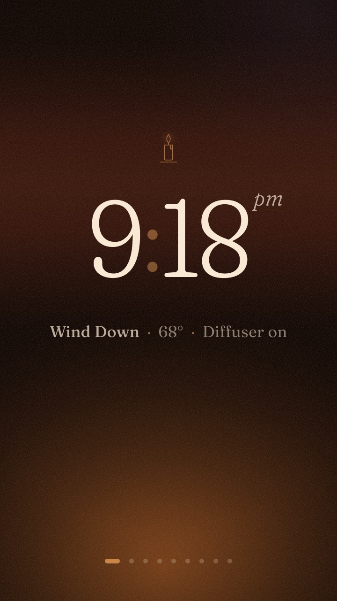
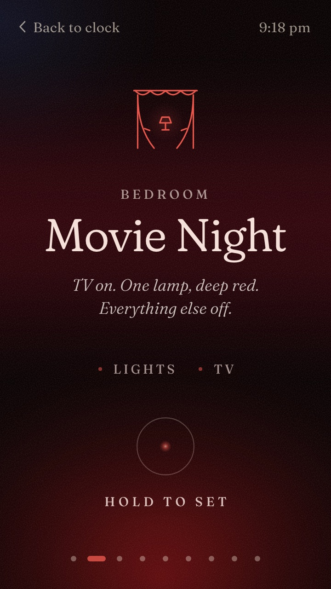
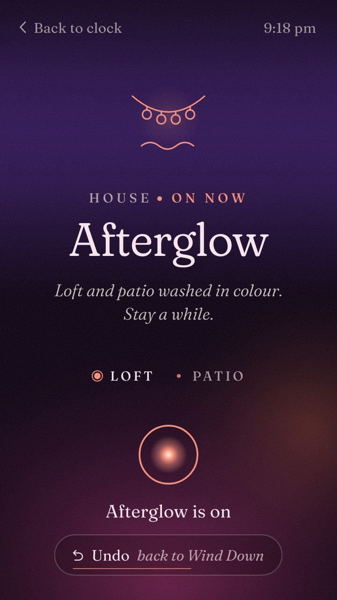
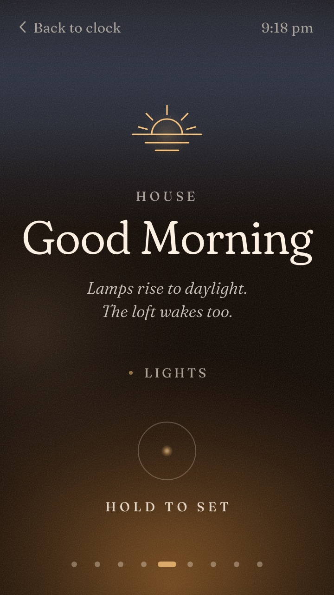
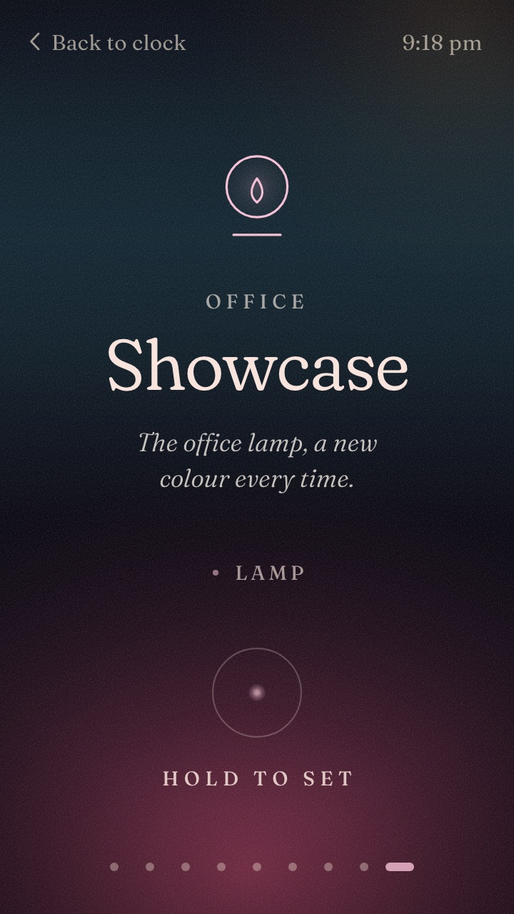
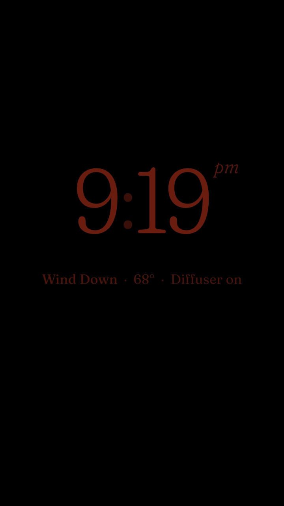

# Palm Moods

A mood controller for Home Assistant that runs on a rooted Palm PVG100. The phone sits on a wall or a nightstand and shows a clock. Tap it to open a deck of moods (Wind Down, Movie Night, Lights Out, Good Morning, ...), swipe to the one you want, and press and hold for 600 ms to set it. Small marks under the card fill in as Home Assistant confirms each part: the lamps came on, the TV is on, the bed is cooling.

The moods live in Home Assistant, not on the phone. Each one is a script plus a few attributes for its card. Voice, automations, the Home Assistant app and every Palm all set the same moods and see the same current mood.

| | | |
| --- | --- | --- |
|  |  |  |
| Idle face | The deck | Just set, with marks and Undo |
|  |  |  |
| Good Morning | Showcase (an example mood) | Night face |

The screenshots are 720x1280, the Palm's own resolution, rendered in headless Chrome against the fake Home Assistant in `ui/dev/`.

Tested on a US PVG100 (Android 8.1, Chrome 101 WebView), firmware v1AGN and v3C3M, with Home Assistant 2026.11. You need the phone rooted first: see [backup and root](../../docs/backup-and-root.md).

## How it works

```
Palm phone                                          Home Assistant
  shell/  Kotlin home app: fullscreen WebView,        packages/moods/
          keeps the screen on, brightness,              moods_core.yaml     current mood, begin, undo
          haptics, light + proximity sensors,           moods_roles.yaml    your devices (the only file
          Wi-Fi lock, crash recovery                                        that names them)
  ui/     "Ember" web UI, bundled in the APK  <-- ws -->  <mood>.yaml       one file per mood
          talks to HA over the WebSocket API            moods_settings.yaml dashboard settings
          with a long-lived token                     dashboards/palm_moods.yaml  the "Moods" dashboard
```

- **The shell** (`shell/`, package `com.palmmoods.shell`) is a small Kotlin app with no AndroidX. It is set as the phone's home app, so it starts at boot. It hosts the web UI, gives it what a web page cannot reach (window brightness, the vibration motor, the light and proximity sensors, battery and Wi-Fi state), and keeps it running: a watchdog reloads a page that stops sending heartbeats, and crashes restart with a back-off. Five quick taps on the clock open Android Settings; Moods comes back by itself after 5 minutes.
- **The UI** (`ui/`) is plain HTML, CSS and JavaScript with no build step and no network fetches. It finds moods by subscribing to `script.*` entities that carry `mood: true`, so a new mood file shows up on every phone after a reload, with no app update. It dims itself at night (by the clock, a dark room, or a night mood like Lights Out) to a red-shifted, motionless face.
- **The Home Assistant package** (`ha/`) holds the moods. A mood names **roles** (`light.role_bedroom_lamps`, `switch.role_diffuser`, `script.role_bed_cool`), never devices. Only `moods_roles.yaml` maps roles to your entity ids, so swapping a lamp is a one-line change and no mood file changes. An empty role is fine; that step just does nothing.

The full contract between the three parts is [docs/ARCHITECTURE.md](docs/ARCHITECTURE.md). The phone survey it was designed against is [docs/device-profile.md](docs/device-profile.md).

### The moods

The package ships with eight moods for an example house (bedroom, office, loft, patio, porch, a guest room), plus an optional Showcase:

| Mood | What it does |
| --- | --- |
| Wind Down | Bedroom lamps low and warm, diffuser on |
| Movie Night | Bedroom TV on, one lamp deep red, every other bedroom lamp off |
| Afterglow | Loft lamp and patio in a slow colour scene |
| Lights Out | Every light off (except the guest room), TV off, speakers paused, bed cools |
| Good Morning | Bedroom lamps rise to daylight in steps; only runs 05:00 to 11:00 |
| Focus | Office lights bright and cool; nothing else changes |
| Hosting | Patio and porch lit warm; can hold the outdoor lights past your own 22:30 night-off automation ([one line to add](ha/README.md#automations-that-fight-moods)) |
| Away | Everything off, thermostat to eco |
| Showcase | Example: the office lamp moves to the next of six colours each time |

None of them plays music yet: the music plumbing is there (`moods_music.yaml`, Music Assistant), with every media id left blank. Details of each mood are in [ha/README.md](ha/README.md#the-moods).

## Install

You need Home Assistant with packages enabled, a rooted PVG100 with USB debugging on, and on your computer `adb`, `python3`, a JDK 17 to 21 and the Android SDK (platform 37).

### 1. The Home Assistant package

1. In `ha/packages/moods/moods_roles.yaml`, replace every example entity id (`light.bedroom_lamp`, `climate.bedroom_bed`, `remote.bedroom_tv`, ...) with your own, or comment it out. This is the only file that names devices.
2. Copy `ha/packages/moods/*.yaml` to `/config/packages/moods/` and `ha/dashboards/palm_moods.yaml` to `/config/dashboards/`. Your `configuration.yaml` needs:

   ```yaml
   homeassistant:
     packages: !include_dir_named packages
   ```

3. Check the config (Developer tools → YAML → Check configuration, or the offline check in [ha/README.md](ha/README.md#check-before-deploying)), then restart Home Assistant once. The restart is what registers the "Moods" dashboard.
4. In Developer tools → States, check that each `script.mood_*` has the attributes `mood: true` and `mood_touches`. If one is missing them, its `customize:` block has a mistake: Home Assistant drops it with only a log warning, and the mood disappears from the phones.

The full install, reload and verify steps are in [ha/README.md](ha/README.md#install).

### 2. A non-admin user and token for the phones

Create a Home Assistant user for the panels (Settings → People → Users) and leave "Administrator" off. Log in as that user once, open its profile, Security, and create a long-lived access token. Everything the phones use (`subscribe_entities`, `call_service` on scripts) works for a non-admin user.

The token is a secret. It goes into a git-ignored config file on your computer, is pushed to the phone last, and the app moves it into private storage and deletes the pushed file.

### 3. Build the app

```bash
(cd homeassistant/moods/shell && ./gradlew testDebugUnitTest assembleDebug)
```

The APK is `shell/app/build/outputs/apk/debug/app-debug.apk`. The `copyUiAssets` task bundles `ui/` into it (without `ui/dev/`). See [shell/README.md](shell/README.md).

### 4. Provision a phone

```bash
cd homeassistant/moods
cp tools/config.example.json tools/config.bedroom.json
chmod 600 tools/config.bedroom.json
# edit it: haUrl (the LAN IP, e.g. http://192.168.1.10:8123) and token
tools/provision.sh <adb-serial> bedroom
```

`<adb-serial>` comes from `adb devices`; `bedroom` is the panel name, which decides which moods the phone shows first and which phone settings it reads from the dashboard. Use the LAN IP, not `homeassistant.local`: Android 8.1 does not resolve `.local` names.

The script checks everything before it changes anything, then installs the app, makes it the home app, turns off the swipe keyguard and the double-press camera gesture, resets any display density override, installs the toolkit's [charge limiter](../../scripts/charge-limit/), and last pushes the config and starts Moods. It saves the phone's original values in `tools/state/<serial>.env`. Every change and the command that undoes it is listed in [tools/README.md](tools/README.md).

With no config at all the app runs in demo mode (five demo moods and a small "Demo" tag), which is a quick way to check the build on a phone.

## Add or change a mood

A mood is one file. To add one:

1. Copy a mood close to what you want: `cp ha/packages/moods/showcase.yaml ha/packages/moods/reading.yaml`. `showcase.yaml` is the smallest; `focus.yaml` shows a mood with a dashboard setting.
2. Rename the two keys, `script.mood_showcase` under `customize:` and `mood_showcase:` under `script:`, to `script.mood_reading` and `mood_reading`. Set `mood_slug` to `reading` too.
3. Change the card: `mood_name`, `mood_tagline`, `mood_scope` (the room shown on the card), `mood_order` (moods sort by it), `mood_panels` (phones that show it first), `mood_glyph`, `mood_palette` and `mood_status`.
4. List the confirmation marks in `mood_touches`: each is a role entity and the state it should reach.
5. Change the actions in the script. **Keep its first two steps exactly as they are** (the `script.mood_begin` call and the condition on `begin.proceed`): they record the mood, make Undo work, and apply vacation mode and time windows. Target roles, never devices, and keep `continue_on_error: true` on each action.
6. Reload **Location & customizations**, then **Scripts**. The new card appears on every phone within a second or two.

To change a mood, edit its file and reload the same two. To remove one, delete its file and reload. To swap a device, edit its role in `moods_roles.yaml` and reload **Group entities** (and **Template entities** or **Scripts** for the TV, bed and thermostat wrappers).

The card text, the palette fields and the available glyphs are described in [ha/README.md](ha/README.md#how-to-add-a-mood) and [ui/dev/README.md](ui/dev/README.md#adding-to-the-look). Before deploying, run the checks below; `lint.js` holds the approved card text for every mood in `APPROVED_TEXT`, so add yours there.

## The settings dashboard

The package adds a "Moods" dashboard to the Home Assistant sidebar, for anyone with a Home Assistant login. It has three tabs:

- **Moods**: the current mood and the one before it, a button for each mood (each asks before it changes the house), Undo, and one setting per mood: how warm and low Wind Down's lamps are, how red Movie Night's lamp is, how cool the bed gets at Lights Out, how bright Good Morning gets, and so on. Every option is checked inside the mood, so a bad value falls back to the usual one rather than doing something odd. There is also a safety section (the guest room switches, vacation mode) and "put every setting back to Usual".
- **Phones**: for each Palm, its night hours and how bright its screen is by day. The helpers exist for the panels `bedroom` and `living_room`; copy them for other panel names.
- **Devices**: which devices fill each role, and which of them are not answering.

The settings are plain `input_select` helpers whose first option is the built-in behaviour, so nothing needs seeding. They are listed in [ha/README.md](ha/README.md#the-settings-screen-moods-in-the-sidebar). There is no screenshot of the dashboard here.

## Checks

From `homeassistant/moods/`:

```bash
node ui/dev/lint.js                       # Chrome 101 limits, palettes, card text, settings
node ui/dev/mood-yaml.js --check          # the UI's YAML reader against PyYAML (needs uv)
python3 tools/test_check_config.py        # config parser cases shared with the app
python3 -m http.server 8766 -d ui &       # then, with Google Chrome installed:
node ui/dev/drive.js                      # end-to-end run against the fake Home Assistant
(cd shell && ./gradlew testDebugUnitTest assembleDebug)
```

`ui/dev/fake-ha.js` is a fake Home Assistant that loads the real package files, so you can try a mood on the UI without touching your house. `?mock=1` on `ui/index.html` runs the demo moods in a desktop browser. See [ui/dev/README.md](ui/dev/README.md).

## Known limits

- **The panels run a debug build.** WebView remote debugging is on, so anyone with adb access to the phone can read the token. On a rooted phone adb is already root, so this adds little, but treat the phone as holding the token.
- **Plain `ws://` on the LAN.** The app talks to Home Assistant over an unencrypted WebSocket unless you give it a `wss://` URL. Use a non-admin user for the token.
- **Old Android and Chrome.** Android 8.1 with a 2019 or 2021 security patch, and a Chrome 101 WebView. The UI avoids everything newer (no `:has`, container queries, `dvh`, nesting, `color-mix`) and `lint.js` enforces it.
- **The screen is an LCD.** "Always on" means the backlight stays on. The night face goes down to about 1/255, but it is never truly off unless you turn the screen off.
- **2.4 GHz Wi-Fi only.** The first tap after a long idle can be slow if the Wi-Fi was in power save; the UI keeps a socket open and pings it every 30 s to avoid that.
- **Marks are confirmations, not guarantees.** A mark fills when the role reaches the expected state within 8 s. The bed mark means "the bed is cooling", not "this exact temperature landed".
- **Customize mistakes are silent.** `check_config` does not validate a mood's card attributes. A broken block loses the mood's card with only a log warning.
- **No music out of the box,** and no voice on the phone itself. Voice works through whatever already sets your Home Assistant scripts.
- **The guest room night light is opt-in** and off by default. Turn it on only after the supervised test in [ha/README.md](ha/README.md#safety).
- **Tested only on the US PVG100.** The PVG100E should behave the same, but nobody has tried it here.
