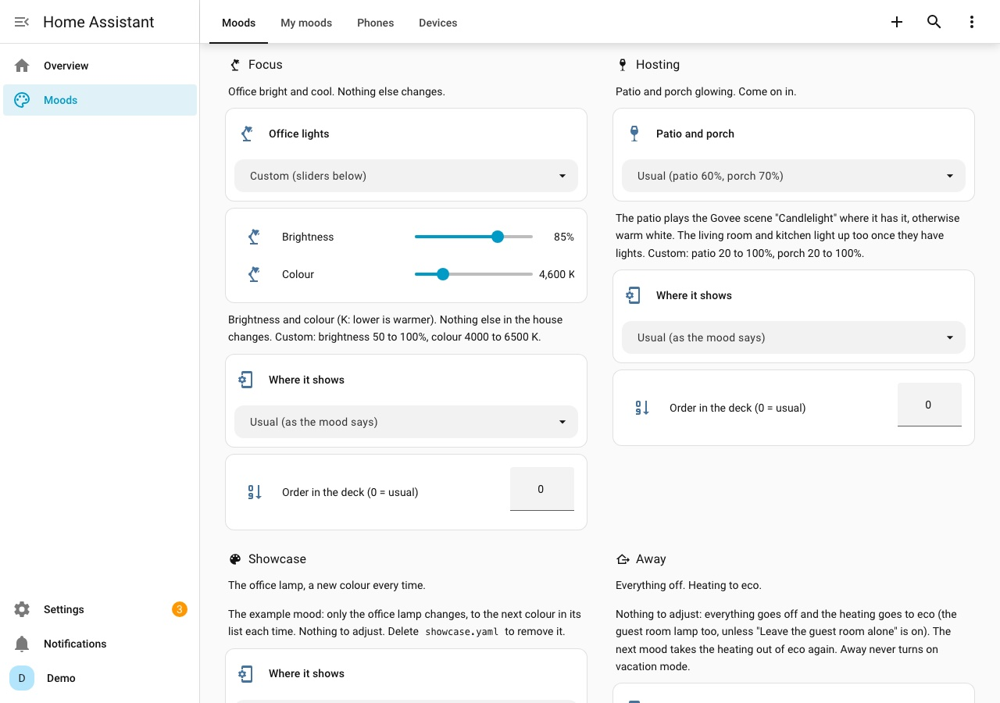
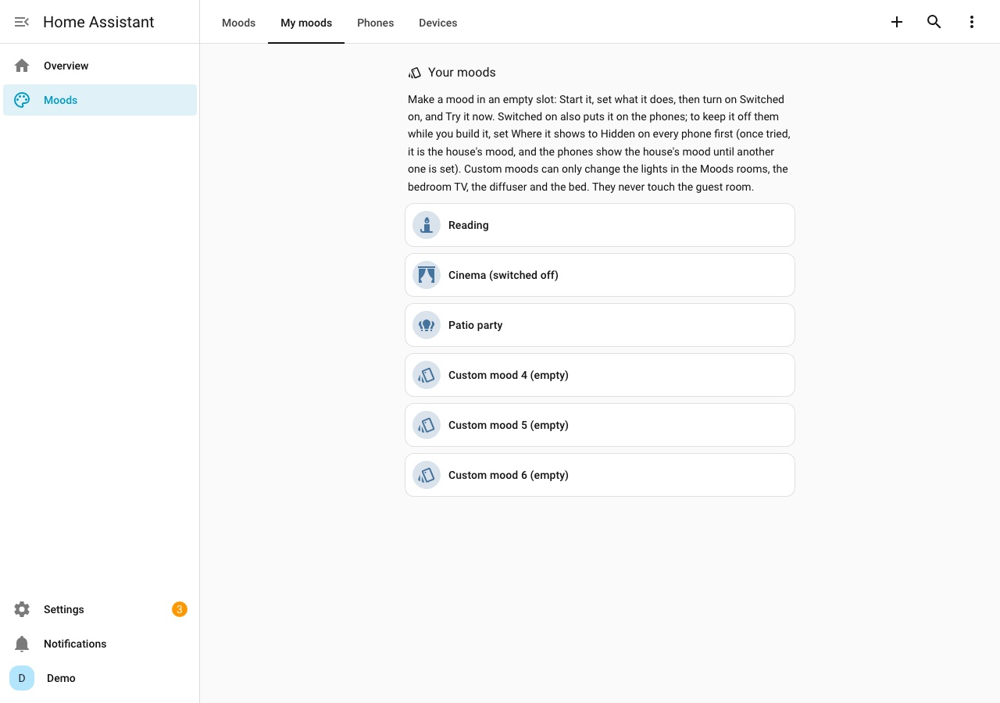
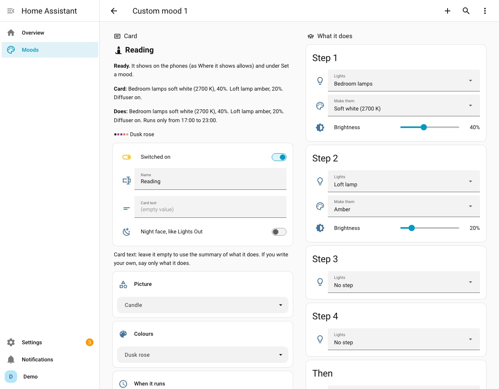

# Palm Moods: the Home Assistant package

This folder is the Home Assistant half of Palm Moods. Every mood is a script in Home Assistant, so the Palm phones, voice, automations and anything else that can call a script all set the same moods and see the same current mood. The contract is section 2 of [`docs/ARCHITECTURE.md`](../docs/ARCHITECTURE.md).

It goes into your Home Assistant config as `packages/moods/`, and the settings screen's dashboard file into `dashboards/` (see [Install](#install)).

**Every device entity id in `moods_roles.yaml` is an example for a generic house** (`light.bedroom_lamp`, `climate.bedroom_bed`, ...). Replace them with your own before you install; nothing else needs to change.

## Layout

```
ha/packages/moods/
  moods_core.yaml     current/previous mood, the refusal notice, script.mood_begin,
                      script.mood_undo, binary_sensor.mood_outdoor_hold and the
                      package's one automation (outdoor lights off late)
  moods_roles.yaml    THE ONLY FILE WITH REAL DEVICE ENTITY IDS
  moods_music.yaml    each mood's music (a mood can also carry its own)
  wind_down.yaml      one file per mood: the script plus its card metadata
  movie_night.yaml
  afterglow.yaml
  lights_out.yaml
  good_morning.yaml
  focus.yaml
  hosting.yaml
  away.yaml
  showcase.yaml       an optional example mood (recolours one lamp; delete to remove)
  moods_settings.yaml the settings on the "Moods" dashboard (one input_select per
                      mood, its Custom sliders, and two per phone), where each mood
                      shows and its order in the deck, "put every setting back",
                      and the dashboard's registration
  moods_custom.yaml   GENERATED by ui/dev/gen-custom.js: the six custom mood slots
                      made on the dashboard (see Custom moods). Never edit by hand
ha/dashboards/
  palm_moods.yaml     the "Moods" dashboard itself (YAML mode). Deployed to
                      /config/dashboards/, NEVER under packages/. Its six slot
                      subviews, between marker comments, are generated too
```

**Why `moods_core.yaml` and not `_core.yaml`.** The package is meant to be loaded with `!include_dir_named packages`. That walks sub-folders, and it names each package after the file's basename. Home Assistant requires that name to be a slug. `_core` and `_roles` are not slugs, so HA logs "Invalid package definition" and skips the whole file. A real `check_config` run confirms this.

The same rule means **every file basename must be unique across your whole `packages/` tree**, sub-folders included. If two files share a name, the later one silently replaces the earlier. If you already have a package called `away.yaml` or `focus.yaml`, rename one of them.

## How a mood runs

1. The phone calls `script.turn_on` on `script.mood_<slug>`.
2. The mood first calls `script.mood_begin` and waits for the answer. It passes its slug, which it takes from its own script name, so a copied file can never record itself under the wrong mood.
   - **Two moods at once.** If two moods are chosen within a few milliseconds of each other (two phones, or voice plus a phone), the newer choice wins. The older one steps aside without writing anything.
   - **Vacation mode.** While `input_boolean.vacation_mode` is on (an optional helper: if your house has no such entity, this check never refuses anything), `mood_begin` refuses every mood except `away`, and the mood stops there. It says why in `input_text.house_mood_notice` (see [Refusals](#refusals)). This check always comes first.
   - **A custom mood that is not ready.** A custom mood slot (`script.mood_custom_<n>`, see [Custom moods](#custom-moods)) is refused like vacation mode when its card is not ready: cleared, switched off on the dashboard, nothing to do, or a card that cannot be read. The reason is the card's own ("Reading is switched off on the Moods dashboard."). This comes after vacation mode and before the time window.
   - **Time window.** A mood may carry `mood_window: { from: "HH:MM", to: "HH:MM" }` in its card metadata (in the example only Good Morning, 05:00 to 11:00; a custom mood takes it from its card). Outside it, `mood_begin` refuses the mood the same way, with the reason "Good Morning only runs between 05:00 and 11:00." See [Time windows](#time-windows).
   - Otherwise it stops any other mood that is still running (custom moods included), so Good Morning's slow lamp rise cannot undo Lights Out a minute later.
   - **Leaving Away.** If the current mood is `away` and the new one is not, it starts `script.role_thermostat_resume`, which takes the thermostat out of eco.
   - It moves the current mood to `input_text.house_mood_previous`. Re-running the current mood keeps the previous one unchanged, so Undo still works.
   - It writes the slug to `input_text.house_mood`, the time to `input_datetime.house_mood_since`, and clears the notice.
3. If the mood has a setting on the [settings screen](#the-settings-screen-moods-in-the-sidebar), it reads it next, in one `variables:` step (the chosen option's numbers, or its sliders when the setting is "Custom (sliders below)"), and checks every value. Anything it cannot use gives today's value.
4. The mood runs a `parallel:` block of role actions, each with `continue_on_error: true`. A missing device, an empty role or a cloud outage skips that step only.
5. `script.mood_undo` re-runs the previous mood.

The card text, palette and glyph come from `homeassistant: customize:` attributes on the mood's script. The UI finds moods by looking for `mood: true` (custom mood slots carry `mood_slot` instead, see [Custom moods](#custom-moods)). `input_text.house_mood` reads `unknown` until the first mood is ever set.

### Refusals

`input_text.house_mood_notice` is empty while the last request was accepted. When a mood is refused, it reads

```
<slug>|<ISO time with microseconds>|<reason>
e.g. focus|2026-01-01T12:00:00.000000+00:00|Vacation mode is on, so only Away can run.
     good_morning|2026-01-01T14:30:00.000000+00:00|Good Morning only runs between 05:00 and 11:00.
```

The time makes each refusal a new state, so a phone that is watching `state_changed` sees every one, including repeats. It is cleared on the next accepted mood. `mood_begin` also fires an event `mood_refused` with `slug` and `reason`, for automations. A refused mood writes nothing else: `house_mood`, `house_mood_previous` and `house_mood_since` stay as they were, and none of its role actions run. The phones show the reason with the error haptic.

**One exception: re-tapping a mood that is still running.** Every mood script is `mode: restart`, so Home Assistant stops a mood's earlier run the moment the same mood is started again, before `mood_begin` is even reached. If that new run is then refused, the earlier run stays stopped where it was. With Good Morning, the lamps stay at whatever step the rise had reached, and `house_mood` still reads `good_morning` (it was accepted when it started). This happens in two ways: Good Morning started in the last 90 s before 11:00 and tapped again after 11:00, or vacation mode turned on while a mood is running and that mood tapped again. Nothing is written beyond the notice; it is only the earlier run that stops. This was left as it is because the alternatives are worse: `mode: single` would ignore the re-tap silently, with no notice and no error haptic, and `mode: parallel` would let two rises run side by side. A choice that loses to a newer one (see above) is not a refusal and writes nothing.

### Time windows

A mood can be limited to part of the day with one optional customize attribute on its script:

```yaml
    script.mood_good_morning:
      mood_window: { from: "05:00", to: "11:00" }
```

- `mood_begin` reads it from the calling script's entity id (`script.mood_<slug>`), never by `mood_slug`, like everything else in the package.
- **Rules.** Times are Home Assistant's local time. `from` is inclusive and `to` is exclusive, so Good Morning runs from 05:00:00 to 10:59:59 and is refused at 11:00. A `from` later than `to` crosses midnight: `{ from: "22:00", to: "02:00" }` runs from 22:00 until 02:00. No attribute (or `null`) means no window.
- **Refusal.** Outside the window the mood is refused exactly like vacation mode (notice, `mood_refused` event, nothing else written). A re-tap of a Good Morning that is still rising when 11:00 passes is refused too, but it has already stopped that rise (see [Refusals](#refusals)). The reason uses the card name: "<mood_name> only runs between <from> and <to>." Undo into a windowed mood outside its window is refused the same way, and the phones show the reason on the face. Vacation mode is checked first, so with both, the reason is the vacation one.
- **Quote both times.** In YAML 1.1 an unquoted `11:00` is the number 660 (base 60). An unquoted `05:00` stays a string only because of its leading zero.
- **A malformed window never blocks the mood.** This covers a value that is not a map, a missing time, a time that is not `HH:MM`, and `from` equal to `to`. The mood runs as if it had no window, and every run logs a warning from `palm_moods.mood_begin` (Settings → System → Logs), naming the script and the bad value. Failing open matches the rest of the package: a broken guard should not silently make a mood unusable, and before the window existed the 600 ms hold was the only guard. `node ui/dev/lint.js` rejects a malformed `mood_window` in the package (and any window not listed in its `APPROVED_WINDOWS`), so it should never reach Home Assistant.
- Afterglow and every other mood have no window.

## The settings screen ("Moods" in the sidebar)

A dashboard inside Home Assistant where anyone with a Home Assistant login can see and adjust Palm Moods without touching YAML.

**What is on it**
- **Moods view:**
  - **Now:** the current mood with its tagline, since when, its status, and the mood before it. Two alerts appear when they apply: vacation mode is on, or the last request was refused (the reason, the mood and the time, from `input_text.house_mood_notice`).
  - **Set a mood:** a button for each mood in this package, one for each custom mood that is ready (named from its card), and Undo (hidden while there is no previous mood). The built-in buttons are listed by hand in the dashboard file. The Showcase button (and its section below) shows only while `script.mood_showcase` exists, so deleting `showcase.yaml` hides it. Every button asks first ("Set the house to Lights Out now? Every light in the house goes off..."), on the tile and on its icon, so a stray click on a laptop does nothing.
  - **One section per mood:** its approved tagline (read from the mood, so it never drifts), its one setting, its sliders (shown only while the setting is "Custom (sliders below)"), one honest line on what the setting changes and what stays, and where it shows on the phones and its order in the deck.
  - **Safety:**
    - "Leave the guest room alone" (a plain switch; on only makes moods do less).
    - "Lights Out may light the guest room night light" (switches only after a confirmation that names the supervised test below).
    - Vacation mode, as a line of text ("Vacation mode is on/off (set elsewhere)", or that the house has no `input_boolean.vacation_mode`), not a tile. Such a flag usually belongs to another system (an alarm or a presence simulation) and may arm its alerts, so the page never offers to change it.
    - One line on what the guest room switches mean right now, and the rules that hold whatever the page says.
  - **Settings:** "Put every setting back to Usual" (asks first; it also puts every slider back at its Usual value and every placement back to Usual), and a short "how to add a mood" pointer.
- **My moods view:** the six custom mood slots, one tile each, named after the mood ("Custom mood 3 (empty)" for an unused one, "Reading (switched off)" for one that is off) with its chosen picture. A tile opens that slot's own page; see [Custom moods](#custom-moods).
- The four views show as text tabs (Moods, My moods, Phones, Devices), with no icons, so they can be told apart on a phone where there is no hover tooltip.
- **Phones view:** for each Palm, its night hours and its day screen brightness.
- **Devices view:** every role with its devices and their states, which ones are not answering, and the bed, TV and heating mirrors.

**The settings**

| Setting (helper) | Options (the first is today's behaviour) | Read by |
| --- | --- | --- |
| Wind Down: lamps (`input_select.moods_wind_down_look`) | Usual (25%, 2200 K), Dimmer (15%, 2200 K), Candlelight (10%, 2000 K), A little brighter (40%, 2700 K), Custom (sliders below): `_look_1` 10..50%, `_look_2` 2000..3000 K by 100 | `wind_down.yaml`: brightness 10..50%, colour 2000..3000 K |
| Movie Night: red lamp (`input_select.moods_movie_night_look`) | Usual (6%), Darker (3%), A little brighter (12%), Custom (sliders below): `_look_1` 1..20% | `movie_night.yaml`: 1..20% |
| Afterglow: loft and patio (`input_select.moods_afterglow_look`) | Usual (loft 45%, patio 55%), Softer (30%, 35%), Brighter (65%, 80%), Custom (sliders below): loft `_look_1` 10..80%, patio `_look_2` 10..100% | `afterglow.yaml`, both the scene and the colour fallback: loft 10..80%, patio 10..100% |
| Lights Out: the bed (`input_select.moods_lights_out_bed`) | Usual (66 °F), Cooler (62 °F), A little cooler (64 °F), A little warmer (68 °F), Warmer (70 °F), Custom (sliders below): `_bed_1` 62..70 °F | `lights_out.yaml`: 62..70 °F, then the wrapper's own 60..75 °F clamp |
| Good Morning: how bright it gets (`input_select.moods_good_morning_look`) | Usual (lamps up to 70%, loft 50%), Gentler (50%, 35%), Softest (35%, 25%), Custom (sliders below): top `_look_1` 30..70%, loft `_look_2` 10..80% | `good_morning.yaml`: top 30..70%, loft 10..80%. The four steps are spread evenly from 10% to the top (10/30/50/70 as usual) and the "still on and not dimmed" check uses the same steps |
| Focus: office lights (`input_select.moods_focus_look`) | Usual (100%, 5000 K), Softer (75%, 4500 K), Crisp daylight (100%, 6000 K), Custom (sliders below): `_look_1` 50..100%, `_look_2` 4000..6500 K by 100 | `focus.yaml`: 50..100%, 4000..6500 K |
| Hosting: patio and porch (`input_select.moods_hosting_look`) | Usual (patio 60%, porch 70%), Softer (40%, 50%), Brighter (80%, 100%), Custom (sliders below): patio `_look_1` 20..100%, porch `_look_2` 20..100% | `hosting.yaml`: both 20..100%. The living room and kitchen stay as they are |
| A Palm's night hours (`input_select.moods_panel_<panel>_night_hours`) | This phone's own hours, 21:00 to 06:00, 21:30 to 06:30, 22:00 to 07:00, 22:30 to 07:00, 23:00 to 07:30, No night hours | the phone (contract section 3) |
| A Palm's screen by day (`input_select.moods_panel_<panel>_screen`) | Usual (100%), Dimmer (70%), Dimmest (50%), Brighter (140%) | the phone: its day levels times that share; night is untouched |
| Where a mood shows (`input_select.moods_<slug>_where`, one per mood and per custom slot) | Usual (as the mood says), First on every phone, Only on the Bedroom Palm, Only on the Living room Palm, Not on the Bedroom Palm, Not on the Living room Palm, Hidden on every phone | the phones from app 0.2.0, by exact text (contract section 3). A phone on the 0.1.0 app ignores it |
| Order in the deck (`input_number.moods_<slug>_order`) | 0 (usual: the mood's own `mood_order`), or 1 to 999 | the phones from app 0.2.0. A phone on the 0.1.0 app ignores it |

The sliders are `input_number.moods_<slug>_look_<i>` (`_bed_1` for Lights Out), the i-th number of the setting; each slider's min and max are exactly the range in the last column. Away and Showcase have nothing to adjust. The ranges were chosen so that every option keeps the mood's approved card text and its confirmation marks true: Wind Down stays "low and warm", Focus "bright and cool", Good Morning at most 70%, and the bed between 62 and 70 °F, so "Bed cools" holds and the Bed mark (75 °F or below) still fills.

**How a setting fails to today's behaviour.** Each setting is an `input_select` with no `initial:`, and its first option is today's behaviour. That matters because of three Home Assistant rules, read in the 2026.11.1 source and seen in a throwaway run:
- A new `input_select` starts at its first option.
- It restores the last choice after a restart.
- A restored choice that is no longer in the list falls back to the first option.

So nothing needs seeding: after installing, every mood behaves exactly as before until someone picks something else. An `input_number` was not used for the setting itself because it starts at its minimum, and with `initial:` it would reset on every restart.



**Custom (sliders below).** The last option of each of the seven mood settings. While it is chosen, the mood takes its numbers from its sliders instead of from the option text: the slider states with a trailing `.0` dropped ("25.0" is 25), in the same all-or-nothing check below. So a slider that is `unknown`, `unavailable`, `nan` or removed, a decimal ("75.5", set through `input_number.set_value`, which does not enforce the step), or a value out of range written into the state machine gives ALL of the mood's usual values, never a mix with the other slider. So does Custom while `input_boolean.moods_sliders_seeded` is not on (before the sliders have been put at Usual; see below). A slider move or `input_number.set_value` cannot leave the range, since its min and max are the mood's range. The one value `set_value` lets through is `nan`: the mood reads it as unusable, but a restart would bring that slider back at its min. So when a slider reads `nan`, `automation.moods_put_a_custom_slider_set_to_nan_back_at_usual` (YAML id `moods_sliders_nan_to_usual`) puts every slider of that setting straight back at its Usual value. While any other option is chosen the sliders are not read at all, so moving them changes nothing.

The sliders have no `initial:`, so each keeps its value across restarts. A new `input_number` starts at its min, so `automation.moods_put_the_custom_sliders_at_usual_once` (YAML id `moods_sliders_seed_once`; Home Assistant builds the entity id from the alias) puts every slider at its mood's Usual value, through `script.moods_sliders_usual`, then turns on `input_boolean.moods_sliders_seeded` (no `initial:`) and saves restore state. It runs at a start, right after a reload of **Automations**, and when that boolean turns off (including when it is first created), but only while the boolean is off and all 12 sliders and `script.moods_sliders_usual` exist; if setting them fails, the boolean stays off and the next start or reload tries again. So the first install seeds the sliders whether it is done by a restart or by reloading, and it never runs again unless that boolean is turned off (which seeds them again at once). Until it has run, Custom gives Usual.

Home Assistant saves helper states every 15 minutes and at a clean stop, so `automation.moods_save_the_mood_settings_soon_after_an_edit` (YAML id `moods_settings_save_soon`) saves them 10 seconds after any of the seven mood settings or the 12 sliders changes, so a crash or power cut soon after an edit does not undo it. `lint.js` checks the text of these three automations exactly (comments aside), against the sliders and Usual values it finds.

The numbers in the option's text are the values. The mood takes them out of the text (`regex_findall('-?[0-9]+(?:[.][0-9]+)?')`, so a sign or a decimal stays attached to its number) and checks them all at once, in one `ok`:
- every one is a plain whole number (no sign, no decimal point),
- there are exactly as many as it expects, and
- each is inside the mood's own range.

Only when `ok` holds does it use the chosen values, all of them. Otherwise it uses ALL of today's literals, written next to the check, never a mix of chosen and usual values ("Usual (66.9 °F)" or "Usual (25%, 9000 K)" gives Focus, Afterglow, Good Morning and Hosting exactly today's numbers, and "-5" gives Movie Night 6%). That covers a helper that is missing, `unknown` or `unavailable`, garbage text, an option somebody injected with `input_select.set_options`, and an option renamed in YAML while chosen. The template is written so it cannot raise an error. That matters because a `TemplateError` stops a script even with `continue_on_error`, so it would break the mood instead of falling back.

`node ui/dev/lint.js` checks every setting against the mood that reads it:
- the first option starts with "Usual (" and carries exactly the mood's built-in values;
- every option has the right number of values, each inside the mood's range, with no signed or decimal number;
- each mood reads its setting with the shared tokenizer and one all-or-nothing `ok` line that range-checks every number, and every value is `look[i] if ok else <today's value>`;
- exactly the seven known settings are found; each has "Custom (sliders below)" as its last option and nowhere else, one slider per number with min and max exactly that number's range, a step that reaches both ends and the Usual value, no `initial:`, the approved unit, and one conditional card on the dashboard showing exactly its sliders while Custom is chosen;
- each mood's `ok` ranges are exactly the approved ones in the table above (`APPROVED` in `lint.js`), so widening a range and its slider together is a deliberate change to lint;
- the options of the seven settings are frozen in `ui/dev/custom-options.lock.json`: none renamed, removed or moved (a chosen option must survive an update);
- every option is a quoted string;
- every `input_select.moods_*` setting is read by some mood (or is a panel or placement setting the phones understand);
- every mood, built-in and custom, has exactly one `_where` helper with exactly the frozen options and one `_order` helper (0 to 999, step 1).

The helper ids are built from the mood's own script name (`'input_select.moods_' ~ <slug> ~ '_look'`, and the sliders `'input_number.moods_' ~ <slug> ~ '_look_' ~ i`). So a copied mood file finds no setting and no sliders and runs on its own built-in values.

**Adjusting what the screen offers.** Edit `moods_settings.yaml` and keep "Usual (...)" first and unchanged, and "Custom (sliders below)" last. To add an option, add a line just before "Custom (sliders below)" with values inside the mood's range (`lint.js` says if not), and the same line at the same place in `ui/dev/custom-options.lock.json`. Copy the file over, then reload **Input selects**. Do not rename the option that is currently chosen: after the reload the helper reads `unknown` until someone picks again (the moods treat that as Usual), and a restart picks Usual.

**Giving a new mood a setting.** Add `input_select.moods_<slug>_look` to `moods_settings.yaml`, with "Usual (...)" first and "Custom (sliders below)" last, and one `input_number.moods_<slug>_look_<i>` slider per number (min and max the mood's range, no `initial:`), plus a `set_value` step to its Usual value in `script.moods_sliders_usual`. Copy one of the existing `variables:` steps into the mood, right after the `begin.proceed` condition, keeping its reader lines as they are, with one `ok: "{{ look | count == N and LO <= look[0] <= HI and ... }}"` line that range-checks every number and each value as `look[i] if ok else <today's value>` (`lint.js` checks this form). Add the setting's id to `SETTINGS` and its ranges and units to `APPROVED` in `ui/dev/lint.js`, its options to the lock file, and its sliders to the three automations (`lint.js` prints the line it expects), then a section with the conditional slider card to `ha/dashboards/palm_moods.yaml`. After the reloads, turn `input_boolean.moods_sliders_seeded` off once, so the new sliders start at Usual (this also puts the other moods' sliders back at Usual). Without these, the new mood still appears on the phones and runs on its built-in values.

**Who can change what.** Anyone with a Home Assistant login sees the screen (`require_admin: false`). It would hide nothing anyway: any user, the panels' token included, can call `input_select.select_option` from anywhere. The checks inside the moods and the wrappers are what keep a value from doing harm.

**What it does not do.**
- A change applies the next time the mood is set. A mood that is already on stays as it is.
- Some things are not settings, on purpose:
  - the Good Morning window (it is part of `mood_begin`'s refusal rule and the phones' simulator);
  - the rise time (it would widen the documented re-tap edge);
  - free-text Govee scene names;
  - the outdoor-hold numbers (the hold only works once your own outdoor-off automation checks it; see [Automations that fight moods](#automations-that-fight-moods));
  - any switch that would remove what a card promises (the diffuser, the bed, the TV);
  - music;
  - every safety constant.

## The roles (`moods_roles.yaml`)

Moods never name a device. They name a role, and only `moods_roles.yaml` knows which devices fill it.

| Role | Kind | Members in the example | Notes |
| --- | --- | --- | --- |
| `light.role_bedroom_lamps` | light group | `light.bedroom_lamp` | A second light, `light.bedroom_under_bed_light`, is listed but commented out |
| `light.role_bedroom_movie_lamp` | light group | `light.bedroom_lamp` | The one lamp Movie Night keeps on. Must also be in Bedroom lamps |
| `light.role_office_lights` | light group | `light.office_ceiling_light`, `light.office_desk_lamp` | |
| `light.role_office_lamp` | light group | `light.office_desk_lamp` | The colour lamp the Showcase example recolours. Also in Office lights |
| `light.role_loft_lamp` | light group | `light.loft_floor_lamp` | |
| `light.role_guest_room_lamp` | light group | `light.guest_room_lamp` | Only used through the three guest room scripts |
| `light.role_living_room_lights` | light group | *(empty)* | Shows the empty-role style: example ids listed, commented out, inside the brackets |
| `light.role_kitchen_lights` | light group | *(empty)* | |
| `light.role_patio_lights` | light group | `light.patio_string_lights` | |
| `light.role_porch_lights` | light group | `light.porch_light`, `light.porch_wall_light` | |
| `light.role_driveway_lights` | light group | `light.driveway_light` | |
| `light.role_all_lights` | light group | every room role above **except the guest room** | Built from the room roles, so a lamp added to a room is covered automatically |
| `switch.role_diffuser` | switch group | `switch.diffuser_plug` | A smart plug with a diffuser on it |
| `media_player.role_bedroom_speaker` | speaker group | `media_player.bedroom_speaker_2` | Music Assistant players |
| `media_player.role_kitchen_speaker` | speaker group | `media_player.kitchen_speaker_2` | |
| `media_player.role_house_speakers` | speaker group | `media_player.kitchen_speaker_2`, `media_player.dining_room_speaker_2` | |
| `script.role_bedroom_tv_on` / `_off` | wrapper | `remote.bedroom_tv` | A streaming box's remote entity; powering it should wake the TV over HDMI-CEC |
| `binary_sensor.role_bedroom_tv` | mirror | on when `remote.bedroom_tv` is on | For the "TV" confirmation mark |
| `script.role_bed_cool` / `_off` | wrapper | `climate.bedroom_bed` | A bed-cooling climate entity. Temperature is kept between 60 and 75 °F (and within the bed's own limits). Does nothing if the bed's range is not in °F. On a two-sided bed, use one side's entity |
| `binary_sensor.role_bed` | mirror | on when the bed is `heat_cool` with a target of 75 °F or below | For the "Bed" mark. It means "cooling", not "this exact command landed" |
| `script.role_thermostat_eco` / `_resume` | wrapper | `climate.thermostat` | Sets the `eco` preset, or returns from it. `mood_begin` calls `_resume` when the house leaves Away |
| `binary_sensor.role_thermostat_eco` | mirror | on when the thermostat's preset is eco | For the "Heat" mark |
| `script.role_guest_room_night_light` | wrapper | Guest room lamp role | Opt-in. See [Safety](#safety) |
| `script.role_guest_room_night_light_off` | wrapper | Guest room lamp role | Good Morning: turns off only the moods' own night light |
| `script.role_guest_room_lamp_off` | wrapper | Guest room lamp role | Away: stops a night light mid-way, then turns the lamp off |
| `script.role_music_play` / `role_music_stop` | wrapper (in `moods_music.yaml`) | any speaker role | See [Music](#music) |
| `input_boolean.moods_guest_room_night_light` | helper | | **Starts off.** Turn on, after the supervised test, to let Lights Out light the guest room night light |
| `input_boolean.moods_leave_guest_room_alone` | helper | | Starts off. Turn on and moods never touch the guest room lamp at all |

The `binary_sensor.role_*` mirrors exist because a script has no useful on/off state for the phone's confirmation marks to watch. Each mirror reads one device and is defined next to that device's role.

## The moods

| Mood | Order | What it does |
| --- | --- | --- |
| **Wind Down** (Bedroom) | 10 | Bedroom lamps 2200 K at 25%, diffuser on. Soft music on the bedroom speaker once one is configured (none is; see [Music](#music)) |
| **Movie Night** (Bedroom) | 20 | Bedroom TV on. The movie lamp goes deep red at 6% first, then every other bedroom lamp turns off. Bedroom music is paused so the soundbar is free |
| **Afterglow** (House) | 30 | Loft lamp and patio play the Govee scene "Sunset Glow". If the device has no such scene, they fall back to a magenta or coral colour. Music on the house speakers once configured (none is). No time window. The patio (and porch, driveway) go off at 01:00 if Afterglow is still the mood |
| **Lights Out** (House) | 40 | All lights off except the guest room. Guest room night light **only if opted in** (see below). Bedroom TV off, bedroom and house speakers paused, diffuser off, bed to 66 °F. Never starts music. The thermostat is left alone |
| **Good Morning** (House) | 50 | **Runs only from 05:00 to 11:00** (see [Time windows](#time-windows)). Bedroom lamps rise in four steps over about 90 s, from 2700 K at 10% to 5000 K at 70%. The rise stops if someone turns the lamp off or dims it. Loft lamp to 4000 K at 50%. Quiet kitchen radio once configured (volume 0.12; none is). Bed off. Turns off the moods' own guest room night light, if it is still at night-light level |
| **Focus** (Office) | 60 | Office lights at 5000 K, 100%. Nothing else changes |
| **Hosting** (House) | 70 | Patio plays the Govee "Candlelight" scene, or warm white if it has none. Porch warm at 70%. Living room and kitchen roles lit warm (both are empty in the example, so those steps do nothing). Music on the house speakers once configured (none is). Holds the outdoor lights (see [below](#automations-that-fight-moods)) |
| **Away** (House) | 80 | Everything off, including the guest room lamp, gently. TV off, speakers paused, diffuser off, bed off, thermostat to eco. Never starts music. Does **not** turn on vacation mode (the reason is in `away.yaml`). **Choosing any other mood afterwards takes the thermostat out of eco** (so does Undo). If you had eco set by hand before Away, that is undone too |
| **Showcase** (Office), example | 90 | Only the office lamp changes: each time the mood is set, the lamp moves to the next colour in a list of six (coral, amber, teal, azure, violet, magenta). Stateless: the next colour comes from the colour the lamp shows now. Handy for filming a panel. Delete `showcase.yaml` to remove it |

The glyph keys `desk_lamp` (Focus), `glasses` (Hosting) and `key` (Away) are in the UI's glyph set alongside the Ember five, and Showcase uses the neutral `ember` glyph; `node ui/dev/lint.js` fails if a mood file names a glyph the UI does not have.

The five Ember moods (Wind Down to Good Morning) carry the approved mockup palette in full: `base`, `glows` in the order `[lamp, band, counter-light]`, `accent`, `ink` and a hand-tuned `sky`. Focus carries its own hand-tuned bright, cool sky. Hosting, Away and Showcase give only `base`, `glows` and `accent`, and the UI generates their skies.

## How to add a mood

1. Copy a mood file that is close to what you want, for example `cp focus.yaml reading.yaml`. The basename must be unique across your whole `packages/` tree. `showcase.yaml` is the smallest mood to start from.
2. In the new file, change:
   - the customize key `script.mood_focus` to `script.mood_reading`
   - the script key `mood_focus:` to `mood_reading:`. The slug passed to `mood_begin` (and to the music step) comes from this name by itself; do not type it anywhere else
   - `mood_slug` to the same slug. Nothing depends on it: `mood_begin`, Undo, the outdoor hold, the music step and the phones all take the slug from the script's entity id, so a copy that keeps a stale `mood_slug` still behaves as its own mood. The phones log a warning when the two disagree, which is how you spot the slip
   - `mood_name`, `mood_tagline`, `mood_scope`, `mood_order` (moods sort by it; leave gaps of 10), `mood_panels`, `mood_glyph`, `mood_palette`, `mood_status` and `mood_night`. A copied `mood_palette` brings the old mood's hand-tuned `sky:` (and `ink:`) with it: delete those lines to have the phones generate a sky from your `glows`, or retune them (see "Adding to the look" in `ui/dev/README.md`)
   - `mood_holds_outdoor`: `true` only if the mood should keep the porch/driveway lights on past 22:30 (in the example only Hosting)
   - `mood_lights_outdoor`: `true` if the mood turns on any outdoor role (patio, porch, driveway), so the package turns them off at 01:00 if the mood is still current
   - `mood_window`: only if the mood should run at certain hours, e.g. `mood_window: { from: "05:00", to: "11:00" }`, with both times quoted (see [Time windows](#time-windows)). A copy of `good_morning.yaml` brings its window along: delete the line if the new mood should run at any time. Add the new window to `APPROVED_WINDOWS` in `ui/dev/lint.js`
   - the card text (`mood_tagline`, `mood_status`): promise only what the mood really does today. No music while no music is configured, and nothing about the guest room. Add the approved text to `APPROVED_TEXT` in `ui/dev/lint.js`
   - `mood_touches`: one line per confirmation mark. The entity must be a role (`light.role_*`, `switch.role_*`, `binary_sensor.role_*` or `media_player.role_*`), and `expect` is the state it should reach
   - `alias` and `icon`
   - the role actions inside `parallel:`. Keep `continue_on_error: true` on each one, and target roles, never devices
3. **Keep the first two steps exactly as they are**: the `script.mood_begin` call with `response_variable: begin`, and the `condition` on `begin.proceed`. Without them the mood ignores vacation mode, is not recorded, and cannot be undone.
   - A copied file also brings the original's settings step (the `variables:` step that reads `input_select.moods_<slug>_...`). It is harmless: the id is built from the new script's name, so it finds no setting and the mood uses the built-in values written in that step, which are the copied mood's. Change them to the new mood's values, or delete the step and put the values back as plain numbers. To tune the new mood on the dashboard, see [Giving a new mood a setting](#the-settings-screen-moods-in-the-sidebar).
4. Music, if any: either add `music_id:` (and optionally `music_type:`, `music_volume:`) to the mood's `script.role_music_play` step, which keeps it a one-file change, or add a `reading:` entry to `library:` in `moods_music.yaml`.
5. Check it locally (see [Check before deploying](#check-before-deploying)), deploy, then reload as shown under [Reload](#reload).
6. After the reload, run the mood once and check in **Developer tools → States** that `input_text.house_mood` shows the new slug and that the script has `mood: true` and `mood_touches`.

7. **Placement.** Add the mood's `input_select.moods_<slug>_where` (the same seven options as the others, copied exactly) and `input_number.moods_<slug>_order` to `moods_settings.yaml`. `lint.js` fails without them. Then run `node ui/dev/gen-custom.js --write`: the save automation in `moods_custom.yaml` watches every mood's placement helpers, so the generated file changes too.

No app or UI change is needed, unless the mood wants a new glyph. The dashboard's "Set a mood" buttons and each mood's section (with its two placement tiles) are listed by hand in `ha/dashboards/palm_moods.yaml`: add them there too.

Or make the mood on the dashboard's My moods tab instead, with no YAML at all (see [Custom moods](#custom-moods)).

## How to remove or rename a mood

- **Remove:** delete its file, then reload core config and scripts. If it was the current or previous mood, `house_mood` / `house_mood_previous` keep the old slug until the next mood is set. Undo to it just does nothing. Its `library:` entry in `moods_music.yaml` (if any) is ignored, but delete it to stay tidy.
- **Rename** (a new slug): treat it as add-a-mood plus remove-a-mood. Rename the file, the customize key and the script key together (and `mood_slug`, to keep the phones' warning quiet). Also rename its `library:` key in `moods_music.yaml`, if it has one, and change the condition line in any automation that names the old slug.

## How to add or swap a device

Edit one role in `moods_roles.yaml`, then reload. No mood file changes.

- **A new lamp in a room:** add its entity id under that room's light group. All lights picks it up automatically.
- **Empty groups use brackets.** The living room and kitchen groups are written `entities: [` … `]`, one commented id per line, each ending in a comma. To fill one, remove the `# ` in front of an id (or add a new `light.x,` line inside the brackets). **Keep the brackets and the commas.** Do not add `- light.x` lines under a bracketed group; that is a parse error that breaks the whole config.
- **A new room:** add a light group named `"Role: <Room> lights"`, add it to `light.role_all_lights`, and use it from the moods that should light that room.
- **Filling the living room:** remove the `# ` from the `light.living_room_*` lines and change them to your ids (keep the brackets and commas). Hosting already lights that role.
- **A replacement speaker:** put its **Music Assistant** entity in the speaker group. That is the `_2`/`_3`-style one whose integration is `music_assistant`. Don't use the plain Cast entity, a hidden "+"/AirPlay duplicate, or anything in the guest room. `role_music_play` ignores non-Music-Assistant members and anything with "guest room" in its id.
- **A new TV, bed or thermostat:** each of those ids appears **three times**: in the on/eco/cool wrapper, in the off/resume wrapper, and in its `binary_sensor.role_*` mirror. Every copy is marked `SAME ID AS`. Search the file for the old id and change every copy. If you miss one, the mood half-works quietly.
- **A new bedroom lamp that should be the movie lamp:** change it in both Bedroom lamps and Bedroom movie lamp (both lines are marked `SAME ID AS`).
- **A device that is gone:** delete or comment its line. An empty role is fine. It shows as unavailable, and moods skip it with a warning in the log ("Referenced entities ... are missing or not currently available").

## Custom moods

The "My moods" tab of the dashboard makes and edits up to six moods with no YAML: the slots `script.mood_custom_1` to `script.mood_custom_6` (slugs `custom_1` to `custom_6`, reserved). Everything is in `moods_custom.yaml`, which `ui/dev/gen-custom.js` writes; `lint.js` fails if the file, or the six generated subviews in the dashboard, differ from the generator.



**Making one.** Open My moods and tap an empty tile. Its page offers **Start this mood**, which fills the slot with a draft: "New mood", the bedroom lamps soft white at 40%, switched off. Then, top to bottom:
- **Card:** the name (up to 32 characters), the card text (up to 120; leave it empty and the summary of what it does is used), the picture, the colours, when it runs, and whether it gets the night face like Lights Out. The card at the top of the page shows the live summary, any problems, and Ready or Not ready with the reason.
- **What it does:** up to four light steps (which lights, what to make them, brightness), then other lights, the fade, the bedroom TV, the diffuser and the bed.
- **Where it shows:** per phone, and the order in the deck (see [Placement](#placement)).
- **Switched on** publishes it: within a second or two it is on the phones (as Where it shows allows) and under "Set a mood". **Try it now** appears only while it is switched on, because a mood that is switched off is refused. It sets the mood through every rule a mood obeys; while it is the house's mood its page says so and offers Undo, as do the Moods tab and the phones. To keep a mood off the phones while you build it, set Where it shows to "Hidden on every phone" before switching it on. Once you try it, it is the house's mood, and a phone always shows the house's mood (last in its deck) until another mood is set.
- A blank name never empties a slot: a slot with anything in it (switched on, card text, a step, other lights or an extra) keeps its page and shows as "Custom mood N", with a problem line, until it has a name again. **Start this mood** only fills a slot with nothing in it.
- **Clear this mood** (asks first) wipes the slot: name, card, steps and placement. The house is not changed. If the mood before the current one was this slot, `house_mood_previous` is blanked, so Undo never replays a reused slot under its old name. Home Assistant's confirmations and page titles are fixed text, so they say "slot N", not the mood's name.



**What a custom mood can do, and nothing else.**
- Lights: the roles Bedroom lamps, Bedroom movie lamp, Office lights, Loft lamp, Living room lights, Kitchen lights, Patio, Porch and Driveway: white (2000 to 6500 K), one of eight colours, keep its colour, or off, at 1 to 100%.
- Other lights: leave them, turn the other indoor lights off, or every other light (`light.role_all_lights`) off. A lamp that a step turns on is never turned off by another step or by Other lights (the off set is every lamp of the "off" roles and of the other lights, minus every lamp a step lights), so a lamp that is in two roles never blinks.
- The bedroom TV on or off, the diffuser on or off, and the bed off or to 62, 64, 66, 68 or 70 °F, through the same wrappers as the built-in moods (the bed wrapper clamps to 60..75 °F again).
- A fade (instant, 2, 10 or 30 s) and a time window (any time, or one of five preset windows).

**What it can never do.** Touch the guest room (no guest room role is in its tables, `light.role_all_lights` leaves the guest room out, and the runner drops any id containing `guest_room`), the thermostat, a speaker or music, a bed base, or vacation mode. It never holds the outdoor lights past 22:30; outdoor lights it turned on go off at 01:00 if it is still the mood. This follows what the mood's last run did, not the slot as it is at 01:00: the runner writes the slot's slug to `input_text.custom_mood_lit_outdoor` when an "on" step lit the patio, porch or driveway, and empties it otherwise, so editing, switching off or clearing the slot afterwards does not leave the patio on all night.

**How it is built.**
- Each slot is a real mood script: `mood_begin` first, so vacation mode, the time window, newest wins, `house_mood` and Undo all work as for any mood, then one awaited call to `script.moods_custom_run`. When a newer mood stops the slot, the runner is stopped with it. The slot scripts carry `mood_slot: <n>`, not `mood: true`, so a phone on the 0.1.0 app (and anything else that lists `mood: true`) never sees them.
- `sensor.moods_custom_<n>` reads the slot's helpers and holds the card: its state is `ready`, `not_ready` or `empty`, and its one attribute `card` has the same keys as a built-in mood's metadata plus the parsed steps (`mood_steps`, `mood_extras`, `mood_summary`, `mood_problems`, `mood_state`, `mood_reason`). The phones, `mood_begin`, the runner, the 01:00 automation and the dashboard read the card. Its name is a template, so tiles show the mood's real name.
- The runner refuses unless its own slot script is running and is the current mood, vacation mode is off and the card is ready. It maps the card's option texts through its own fixed tables: no text ever becomes an entity id or an action. A step on a role with no lights (the kitchen, in the example) is skipped, so it sends nothing and logs no warning; the card still lists it, with a problem line.
- Garbage in a helper (an option injected with `input_select.set_options`, a value set through the state machine, a missing helper) gives that field's default and a problem line, never a template error. A card that cannot be read means "not ready", which is a refusal.
- The save automation (YAML id `moods_custom_save_soon`; its entity is `automation.moods_save_dashboard_moods_soon_after_an_edit`, from its alias) calls `homeassistant.save_persistent_states` 10 s after the last edit (any slot helper, through its card sensor, or any mood's placement helper). Without it Home Assistant saves restore state only every 15 minutes and at a clean stop, so a crash could lose a quarter of an hour of edits.

**The option texts are frozen** (`ui/dev/custom-options.lock.json`). A slot keeps its choice only while that exact text exists: after a restart, a chosen option that is no longer in the list falls back to the first one, and a step silently becomes "No step". `lint.js` fails when an option is renamed, removed or moved. To add one, append it in `gen-custom.js` (and, for Where it shows, in every `_where` helper in `moods_settings.yaml`) and in the lock file, in the same change, then run the generator.

**Where the moods live.** Not in git: a slot's definition is its helpers' values, in Home Assistant's `.storage/core.restore_state` and in its backups. A restored older backup brings the slots back as they were then. Home Assistant keeps restore data for 7 days after an entity disappears, so removing `moods_custom.yaml` and putting it back within a week keeps the slots.

**Making more slots or steps** is a one-line change in `gen-custom.js` (`SLOTS`, `STEPS`), then `--write`, copying the files over and a restart.

**Known limit.** The sensor's name is a template ("Reading", "Reading (switched off)"), so each rename, each Switched on toggle, Start and Clear writes the entity registry. More than 100 of those in an hour makes Home Assistant log once that `sensor.moods_custom_N` "is updating its capabilities too often"; it is only a warning.

## Placement

Every mood, built-in or custom, has two helpers that decide where it shows on the phones (app 0.2.0 or newer; a phone on 0.1.0 ignores them):
- `input_select.moods_<slug>_where`: "Usual (as the mood says)" (the mood's own `mood_panels`), "First on every phone", "Only on the Bedroom Palm", "Only on the Living room Palm", "Not on the Bedroom Palm", "Not on the Living room Palm" or "Hidden on every phone". The phones match the text exactly.
- `input_number.moods_<slug>_order`: 0 keeps the mood's own `mood_order`; 1 to 999 replaces it. It is a box to type in.

They are at the bottom of each mood's section on the Moods tab, and of each slot's page. A phone shows its moods in three groups: those set to "First on every phone", then that phone's own moods (`mood_panels`, or "Only on" that Palm), then the rest. The order number sorts a mood only inside its group. A custom mood has no `mood_panels` (its order is 110 to 160), so it is in the last group unless Where it shows says "First on every phone" or "Only on" that Palm. Each slot's page lists each Palm's usual deck.

A hidden mood can still be set from the dashboard, by voice and by Undo. The mood that is the house's mood right now is never hidden on a phone: it stays, sorted last, so the face tells the truth. With every placement at Usual, every phone shows exactly the deck it showed before.

The "Bedroom" and "Living room" in the option texts are the example's panel names (`bedroom`, `living_room`). A phone provisioned with another panel name has no "Only on" or "Not on" option of its own, though it follows the others (a mood "Only on the Bedroom Palm" is hidden there too). To add options for it, append them in `gen-custom.js` (`WHERE`), in every `_where` helper in `moods_settings.yaml` and in the lock file, in the same change.

## Music

Music is optional and depends on what your Music Assistant plays from. **The moods ship without music**: every `media_id` is blank, so each mood's `role_music_play` step runs and does nothing, and no card promises music. The plumbing stays so music can be switched on later without touching the moods' structure.

When it is switched on, change the card text in the same change (and `APPROVED_TEXT` plus the music rule in `ui/dev/lint.js`):

1. Open `moods_music.yaml` and fill in `media_id` (and `media_type`) for the moods you want. The file shows the accepted forms; a URI copied from the Music Assistant web UI is the most reliable. Radio Browser works without an account, which suits Good Morning. Alternatively, put `music_id:` (and `music_type:`, `music_volume:`) on the mood's own `script.role_music_play` step; those win over the library.
2. In that mood's file, uncomment its `# - { label: Music ... }` touch line, so the phone shows a mark for it.
3. Reload scripts and core config.

How it behaves:
- With no `music_id` and `media_id: ""`, the mood skips music.
- Music is also skipped if the speaker role has no available Music Assistant player, or if Music Assistant itself is missing.
- Volume is set before playing and capped at `max_volume` (0.35). If the volume cannot be set, nothing plays.
- `lights_out` and `away` are refused inside the wrapper itself, whatever the library or the mood says.

## Safety

These rules are built into the package. Keep them when editing. They hold whatever the [settings screen](#the-settings-screen-moods-in-the-sidebar) says: every setting is checked inside the mood, and the wrappers below keep their own limits on top.

- **A caller cannot override a wrapper's safety values.** In Home Assistant, a script's top-level `variables:` are only defaults, and data passed by the caller wins. Written that way, a direct call such as `script.role_bed_cool` with `target_temp: 90` would send 90 °F to the bed, `script.role_guest_room_night_light` with `night_pct: 100` would light the guest room at 100%, and `script.role_music_play` with `never_music: []` and `max_volume: 1` would play at full volume on a guest room speaker during Lights Out. Any Home Assistant user can make those calls, the panels' token included. So every wrapper in `moods_roles.yaml` and `moods_music.yaml` sets its device ids and limits in a first `variables:` step inside its `sequence`, which a caller cannot override: the same calls send 66 °F (and 75 °F at most), light the guest room at 3%, and play nothing. Keep new wrappers the same way.

- **Bed.**
  - The bed role is one climate entity. On a two-sided bed, point it at one side only.
  - The "cool" wrapper never sends more than 75 °F or less than 60 °F, whatever a mood file says, so a typo such as 96 for 66 cannot heat the bed. If HA ever reported the bed's range in °C, it does nothing.
  - No mood moves a bed base. Moving a bed someone is lying on is not a mood's job.
- **Guest room.**
  - The guest room lamp is not in All lights, and no mood calls `light.turn_on` on it directly.
  - Moods reach it only through the three `role_guest_room_*` scripts. All of them do nothing while `input_boolean.moods_leave_guest_room_alone` is on.
  - **The night light is opt-in.** It does nothing until `input_boolean.moods_guest_room_night_light` ("Moods may light the guest room night light") is turned on. It starts off, and it has no `initial:`, so a restart keeps whatever was last chosen. **Leave it off until the supervised test below has passed.**
  - When opted in, it acts **only if the lamp is off**. It brings the lamp up at 3% in warm amber, then re-sends 3% after 2 s (skipped if the lamp was turned off in between). Lights Out *starts* it rather than waiting for it, so if Lights Out is restarted or replaced within those 2 s, the re-send still happens.
  - If the lamp is already on, it is left exactly as it is, because someone turned it on on purpose. It never raises brightness.
  - Good Morning turns the night light off again only if the opt-in is on and the lamp is still at night-light level (brightness 10/255 or less). A lamp someone set brighter is left alone.
  - Away stops a night light that is mid-way, then turns the lamp off.
  - No speaker role should contain a guest room player, both music scripts skip anything with `guest_room` in its id, and Lights Out never touches guest room audio.
  - **The supervised test.** Some lights (Govee, for one) are sent brightness, then colour, then power. If the bulb ignores brightness while off, it could come on at its last level for a moment before the 2 s re-send pulls it down. Test it once: turn on `input_boolean.moods_guest_room_night_light`, turn the lamp off, run `script.role_guest_room_night_light`, and watch the lamp. Only leave the opt-in on if it never flashes bright.
- **Good Morning stays quiet and yields.**
  - Kitchen radio volume (once a station is configured; none is) is 0.12, under a 0.35 global cap, and the lamps rise gradually to at most 70%.
  - Before each step, the rise checks that the bedroom lamp is still on and at least as bright as the last step left it (with about 5% slack). If someone turned it off or dimmed it, at the lamp, in an app or by voice, the rise stops there.
  - It runs only from 05:00 to 11:00 (`mood_window`). A tap at 02:00 is refused, and the phone says "Good Morning only runs between 05:00 and 11:00." with the error haptic. So is an Undo back into Good Morning after 11:00. See [Time windows](#time-windows).

## Automations that fight moods

This package does not edit your automations. If one of them fights a mood, the fix is a single line in that automation's `conditions:`.

### An automation that turns the outdoor lights off at night

A common one: at 22:30 an automation turns off the porch and driveway lights. That undoes Hosting's porch lights.

`binary_sensor.mood_outdoor_hold` is on while the current mood has `mood_holds_outdoor: true` (in the example only Hosting) and either (the current mood is the script `script.mood_<house_mood>`, found by entity id, never by `mood_slug`):
- it was set less than 4 hours ago, or
- it was set at or after 15:00, and it is not yet 01:00 the next morning.

So a Hosting set at 18:00 holds through 22:30 until 01:00, and one set at 23:30 holds until 03:30. One set at 14:00 holds only until 18:00, so the night-off runs as usual; re-tap Hosting in the evening to hold through the night. The three numbers (`hold_hours = 4`, `evening_from = 15`, `hold_until = 1`) are at the top of the sensor in `moods_core.yaml`.

Add this line to your night-off automation's `conditions:`:

```yaml
  conditions:
    - "{{ not is_state('binary_sensor.mood_outdoor_hold', 'on') }}"
```

It is written to fail open. If the moods package is missing or broken, the sensor is not `on`, and the night-off runs as it always did. Don't write it as `state: "off"`: that form would stop the night-off for good whenever the sensor is missing.

**When the hold ends.** The package's own automation `automation.moods_outdoor_lights_off_late` (in `moods_core.yaml`; it adds an automation, it does not edit one) turns the patio, porch and driveway roles off:
- when the hold ends between 22:30 and 05:00 while the holding mood is still current (e.g. 01:00 after an evening Hosting). If someone chose another mood instead, that mood decides, and nothing is turned off. The 22:30 is the example's night-off time: if yours runs at another time, change `after: "22:30:00"` in that automation to match.
- at 01:00, if the current mood has `mood_lights_outdoor: true` (Afterglow, Hosting) and no hold is on. So Afterglow's patio does not burn all night. Re-tap the mood after 01:00 to light it again.

What this does **not** do: it cannot stop a schedule that lives in a light's own app or cloud. If your outdoor lights also switch off on a vendor schedule, change that schedule too.

### A presence simulation tied to vacation mode

`script.mood_begin` already refuses every mood except Away while `input_boolean.vacation_mode` is on, so moods and a presence simulation cannot both drive the lights. The refusal is shown on the phones through `input_text.house_mood_notice`. No change is needed.

If you would rather the simulation ran only after Away was chosen, add this line to its `conditions:`:

```yaml
    - "{{ is_state('input_text.house_mood', 'away') }}"
```

This would also stop the simulation whenever vacation mode is turned on without Away having been set, which is why it is not the default.

## Check before deploying

Every file must parse, and the package must pass a real Home Assistant config check in a throwaway folder. Nothing touches your Home Assistant:

```bash
D=$(mktemp -d); mkdir -p $D/packages $D/dashboards
printf 'homeassistant:\n  packages: !include_dir_named packages\n' > $D/configuration.yaml
cp -R ha/packages/moods $D/packages/
cp ha/dashboards/palm_moods.yaml $D/dashboards/
uv run --python 3.14 --with homeassistant==2026.11.1 hass --script check_config -c $D
```

No output after "Testing configuration" means it passed. **An exit code of 0 is not a pass**: `check_config` can exit 0 while printing errors, so read the output. HA 2026.11 needs Python 3.14.2 or newer.

`check_config` does not open the dashboard file or check its cards. A card mistake shows only as a red error card on that dashboard; Home Assistant itself is not affected.

**What `check_config` does not catch: card metadata.** HA validates a package's `homeassistant: customize:` block only when the core config actually loads. A mistake there only logs `Package moods_… contains invalid customize` and drops the block, so the mood loses its card metadata and disappears from the phones. After every reload, check in **Developer tools → States** that each `script.mood_*` has `mood: true` and `mood_touches` (or look for that log line).

## Install

1. **Packages.** Your `configuration.yaml` needs packages loaded from a folder:

   ```yaml
   homeassistant:
     packages: !include_dir_named packages
   ```

2. **Edit the roles.** In `packages/moods/moods_roles.yaml`, replace each example entity id with one of yours, or comment it out (an empty role is fine). Developer tools → States lists your entity ids. If you have no bed-cooling device, TV remote or thermostat, point those wrappers at nothing: they check the entity and do nothing when it is missing or unavailable. Also delete the matching `mood_touches` lines (the Bed mark in Lights Out, the TV mark in Movie Night, the Heat mark in Away), or those marks will always say "didn't answer".
3. **Copy the files.** `packages/moods/*.yaml` into `/config/packages/moods/`, and `dashboards/palm_moods.yaml` into `/config/dashboards/`. The dashboard must go to `dashboards/` at the config root: a `.yaml` anywhere under `packages/` is loaded as a package, and the config check then fails with "Invalid package definition". Do not `cp -R .../moods packages/moods` into a folder that already exists: that nests a second copy at `packages/moods/moods/`, and the duplicate basenames silently override each other.
4. **Check** (see [Check before deploying](#check-before-deploying)), then **restart** Home Assistant once. The restart registers the "Moods" dashboard; later changes need only the reloads below.
5. **A user for the phones.** Create a Home Assistant user for the panels, **not an administrator**, log in as it once, and create a long-lived access token under its profile (Security). Everything the phones use works for a non-admin user.
6. **Verify.** After the restart, check in Developer tools → States:
   - every `script.mood_*` except `script.mood_custom_*` exists and has the attributes `mood: true` and `mood_touches`; the six `script.mood_custom_*` must not have `mood: true` (they carry `mood_slot` 1 to 6 instead);
   - `sensor.moods_custom_1` to `_6` exist and read `empty`;
   - every `input_select.moods_*_where` reads "Usual (as the mood says)" and every `input_number.moods_*_order` reads 0;
   - `input_boolean.moods_sliders_seeded` is on, and each of the 12 sliders reads its mood's Usual value (Wind Down 25 and 2200, Movie Night 6, Afterglow 45 and 55, Lights Out 66, Good Morning 70 and 50, Focus 100 and 5000, Hosting 60 and 70);
   - `automation.moods_save_dashboard_moods_soon_after_an_edit`, `automation.moods_put_the_custom_sliders_at_usual_once`, `automation.moods_put_a_custom_slider_set_to_nan_back_at_usual` and `automation.moods_save_the_mood_settings_soon_after_an_edit` exist and are on;
   - `script.mood_good_morning` has `mood_window` `{from: "05:00", to: "11:00"}`, and no other `script.mood_*` has one;
   - `input_text.house_mood` and `input_text.house_mood_notice` exist;
   - `light.role_all_lights` lists the room roles;
   - `input_boolean.moods_guest_room_night_light` is **off** (leave it off until the [supervised test](#safety) has passed);
   - `automation.moods_outdoor_lights_off_late` exists and is on;
   - "Moods" is in the sidebar and opens with no red error cards, with four tabs (Moods, My moods, Phones, Devices), and every `input_select.moods_*` reads its first option ("Usual (...)", "This phone's own hours", or "Usual (as the mood says)");
   - on My moods, make a test mood, switch it on with Where it shows "Hidden on every phone", try it, Undo, then clear it.

## Reload

Customize attributes (the card metadata) reach a script's state whenever the script writes its state. **Reload core config first** so the new customize is loaded, **then scripts**, so each script writes its state with the new attributes.

- **Settings screen, first install:** a restart is needed (Settings → System → Restart). A YAML dashboard is registered only when Home Assistant starts, and there is no reload for it (the reloads create the helpers and the script, but not the sidebar entry). Adding, renaming or removing the `lovelace:` entry also needs a restart.
- **Dashboard file edited:** nothing to reload. Refresh the browser (Home Assistant re-reads the file when it changes).
- **Settings changed** (`moods_settings.yaml` options or helpers): **Input selects** (`input_select.reload`), and **Input numbers** for the sliders and the order boxes. Script changes in it: **Scripts**.
- **Updating from a version without the custom moods or the sliders:** install the phones' app 0.2.0 first if you want placement and custom moods on them (against the old package it shows the same deck as before; a phone on 0.1.0 shows no custom moods and ignores placement). Then copy the files over and restart once. That is simpler than reloading input booleans, texts, selects and numbers, template entities, core config, scripts and automations in the right order. The seed automation puts the sliders at Usual as soon as they all exist; your chosen options are kept.
- **Custom moods regenerated** (a new option, more slots): the same restart.
- **First install of the package:** a restart is simplest. Without a restart:
  1. Developer tools → YAML → **All YAML configuration** (`homeassistant.reload_all`).
  2. Then **Scripts** again (`script.reload`).
- **Mood added or changed:** **Location & customizations** (`homeassistant.reload_core_config`), then **Scripts** (`script.reload`).
- **Role changed:**
  - **Group entities** (`group.reload`) for light, switch and speaker groups.
  - **Template entities** (`template.reload`) for the `binary_sensor.role_*` mirrors and the outdoor hold.
  - **Scripts** for the wrapper scripts.
  - **Input booleans** / **Input texts** for the helpers.
- **Outdoor automation changed:** **Automations** (`automation.reload`).
- **Music library changed:** **Scripts**.

## Known limits

- **Cards depend on customize loading.** A mistake in a mood's `homeassistant: customize:` block is not caught by `check_config`; the mood loses its card metadata and disappears from the phones. Check the attributes after every reload.
- **The Bed mark means "cooling", not "this command landed".** If the bed's own schedule already had it cooling at, say, 68 and the mood's 66 did not land (many bed integrations are cloud-based), the mark still fills.
- **`heat_cool` at 66 °F means "cool"** on the bed integration this was written against. Check what your bed's climate entity does with `climate.set_temperature` and `hvac_mode: heat_cool` before trusting Lights Out with it.
- **Stepped rises.** Some lights ignore `transition`, which is why Good Morning rises in steps. The rise's "still on and not dimmed" check reads the lamp's reported brightness; if a light reports late, the rise may stop early, which errs on the quiet side.
- **Scene names.** Afterglow and Hosting ask for the light effects "Sunset Glow" and "Candlelight" (Govee scene names). A light without them falls back to a colour.
- **`mood_panels`.** The example uses `bedroom`, `living_room`, `office` and `kitchen`. Use whatever panel names you provision the phones with. The phone settings on the dashboard (`input_select.moods_panel_<panel>_*`) exist only for `bedroom` and `living_room`: a phone provisioned as `office` or `kitchen` runs on its own night hours and day brightness until you copy those two helpers (and their dashboard rows) for its panel name.
- **Log noise.** Hosting and Lights Out log a "missing or not currently available" warning for each empty role every time they run.
- **Google Assistant and other voice exposure.** If your voice integration (Google Assistant, Alexa, or Home Assistant's own Assist) exposes every domain, the package's helpers show up there as devices, as the mood scripts do: the 11 settings, the 12 sliders and the seed boolean, the 30 placement helpers, the custom moods' 170 or so helpers, the six slot scripts and the editor scripts (`script.moods_custom_run`, `_start`, `_clear`, `script.moods_settings_usual`, `script.moods_sliders_usual`). None of them is a hole (Start and Clear do nothing without a valid slot, the runner refuses outside its own slot, and every value is checked inside the moods), but it is clutter. With Google Assistant, for example, give `google_assistant:` an `exposed_domains` list without `input_select`, `input_number`, `input_boolean` and `input_text`, or set `expose: false` per entity under `entity_config:`, and `expose: false` for the editor scripts. Keep `script.mood_custom_*` exposed if you want to say "Mood: Custom 1".
- **The dashboard url_path.** `palm-moods` must be free: a storage dashboard with the same url_path would be skipped, with only a log warning.
- **Tested in a throwaway Home Assistant 2026.11.1** with stand-in devices: setting moods, Undo, two moods at once, vacation refusals, time windows and their boundaries, the guest room night light both ways, the Good Morning rise and its stop, the outdoor hold maths, every settings option including hostile and malformed ones, the Custom sliders (every preset unchanged call for call, Custom at each slider's ends, odd slider states giving Usual, seeding on a restart and on reloads, `nan`, a crash after an edit), the custom moods (the card sensors with garbage in every helper, the runner's refusals and its calls, `mood_begin` with slots, placement, Clear, restarts and a crash after an edit), and the dashboard at desktop and phone width for an admin and a non-admin user. The 01:00 and after-22:30 automation triggers were not waited for.
- **Narrow screens.** At 360 px the slider value "2,200 K" is 1 px wider than Home Assistant's fixed value box, so the right edge of the K is clipped; at 390 px it fits.
